<p align="right"><a href="README.md">简体中文</a> · <b>English</b></p>

<div align="center">

<a href="https://leesons.github.io/aotai/">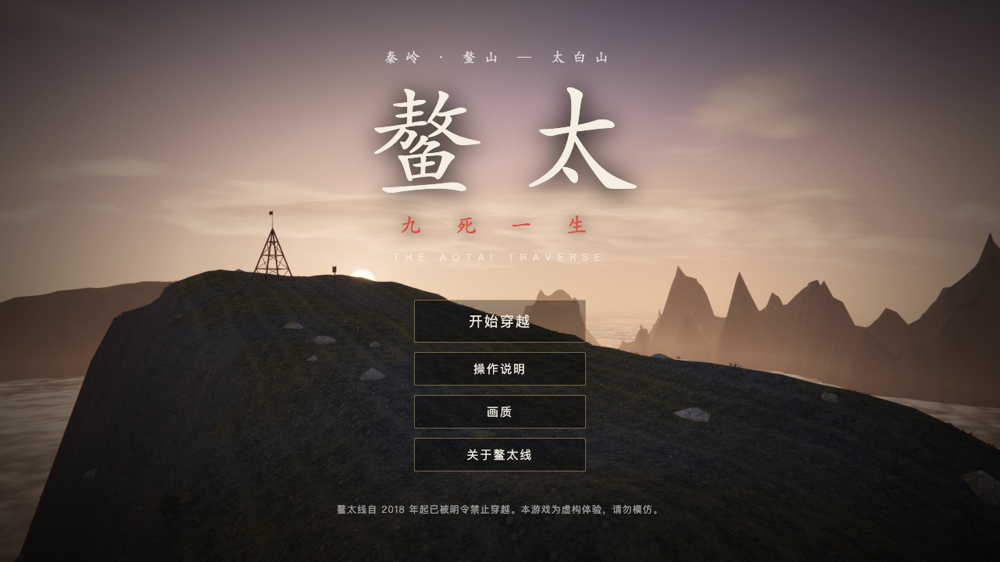</a>

# The Aotai Traverse

**鳌太 · 九死一生** · a hardcore 3D hiking-survival game that runs in your browser

No textures. No models. No audio files. No build step.<br>
Every mountain, cloud, snowflake, footstep and note of music is computed at runtime by about 11,000 lines of JavaScript.

<a href="https://leesons.github.io/aotai/"></a>

[](LICENSE)


[](https://github.com/LeeSons/aotai/stargazers)

[Play](https://leesons.github.io/aotai/) · [What is this](#what-is-this) · [How to play](#how-to-play) · [How it is made](#how-it-is-made) · [Run it locally](#run-it-locally)

<a href="https://leesons.github.io/aotai/">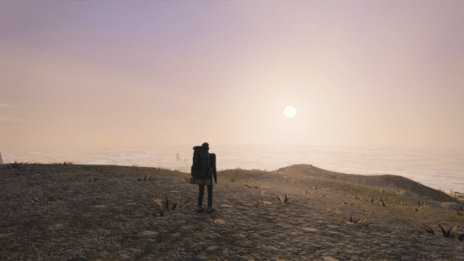</a>

<sub>In-game capture: sunset at the navigation tower · autumn forest trail · the Nine-fold Stone Sea · the cairn field in fog · snow on the main ridge</sub>

</div>

> **Heads-up:** all in-game text is currently in Chinese. The controls are listed below, and a localization PR would be very welcome.

---

## What is this

The Aotai line is a high-altitude ridge traverse across China's Qinling Mountains, linking Mount Ao and Mount Taibai. The main ridge sits at around 3,400 m. Boulder fields run into knife-edge ridges, the weather goes through four seasons in a day, and water sources come and go. Chinese hikers often call it one of the most dangerous trekking routes in the country. It has been officially closed to hikers since 2018.

You cannot walk it in real life, and you should not. So walk it in a browser.

You set out from Tangkou village (1,750 m), cross the navigation tower, Maijie Ridge, the Nine-fold Stone Sea and the Field of Ten Thousand Immortals, summit Baxian Platform on Mount Taibai (3,771 m), then descend all the way to Yingge town. That is 31 landmarks, standing in for roughly 80 km. Before you leave you have 6,000 yuan and one outdoor shop at the village gate.

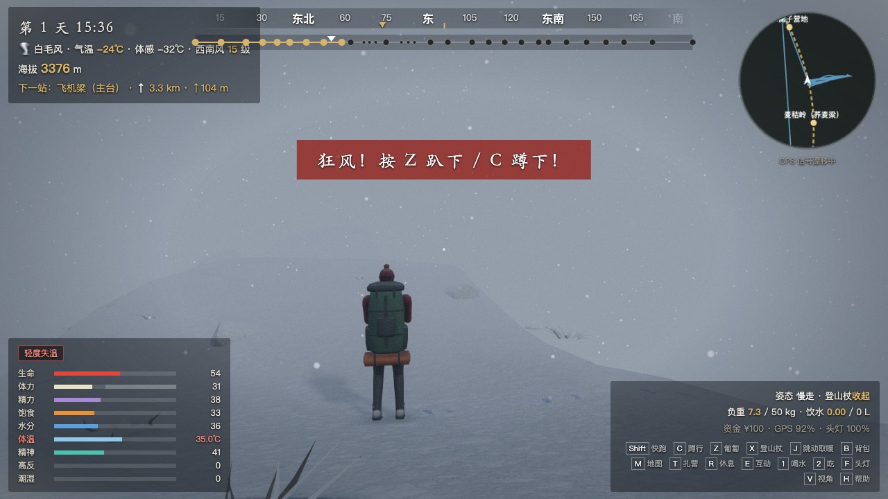

<p align="center"><sub>The main ridge in winter, in a whiteout. Air temperature −24 °C, wind chill −32 °C, force 15 south-westerly, core temperature 35.0 °C. The red line in the middle of the screen is not decoration.</sub></p>

## Why it is worth a click

- **You really can die, and every death has a source.** Hypothermia, falls, injuries in the boulder fields, lightning, high-altitude pulmonary oedema, dehydration, snake venom, a charging takin, tick-borne encephalitis that only shows up a week or two after the bite. There are 16 ways to die, and each one tells you what happens in real life.
- **The first challenge is the shop.** Four backpacks and nearly 50 kinds of supplies, a limited budget, and a pack with a weight limit. One litre of water is one kilogram. A four-season tent, or two more days of food? A GPS, or a satellite messenger?
- **Four seasons are four different games.** In spring the ridge is still under snow. In summer there is a thunderstorm every afternoon. In autumn the water sources dry up. In winter it is −25 °C at night and every water source is frozen.
- **Weather that changes by the hour.** Clear, cloudy, dense fog, cold rain, thunderstorm, hail, sleet, blizzard, gale and whiteout: ten kinds of weather that rotate with season and altitude.
- **A body that follows real rules as closely as we could manage.** Core temperature is computed from heat produced and heat lost. Walking produces heat, food turns into heat, wet clothes stop insulating, and a down jacket in the rain is worth nothing. In severe hypothermia you will start taking your clothes off without noticing.
- **It runs on phones too.** The same URL detects touch screens: left thumb on a joystick, right thumb to look around.

> If you find it interesting, please leave a ⭐. It is the only way more people will see it.

## What the mountain looks like

<table>
  <tr>
    <td width="50%">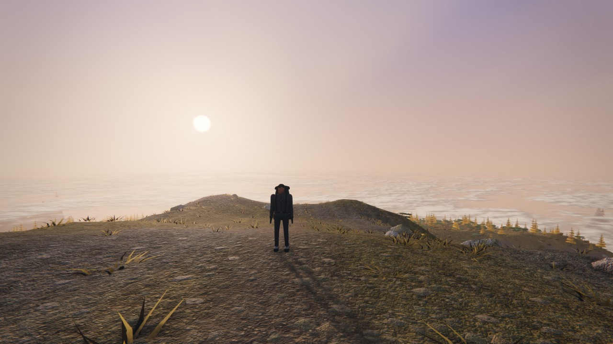<br><sub><b>Navigation tower · 3,476 m</b>　dusk, with the clouds below your feet</sub></td>
    <td width="50%">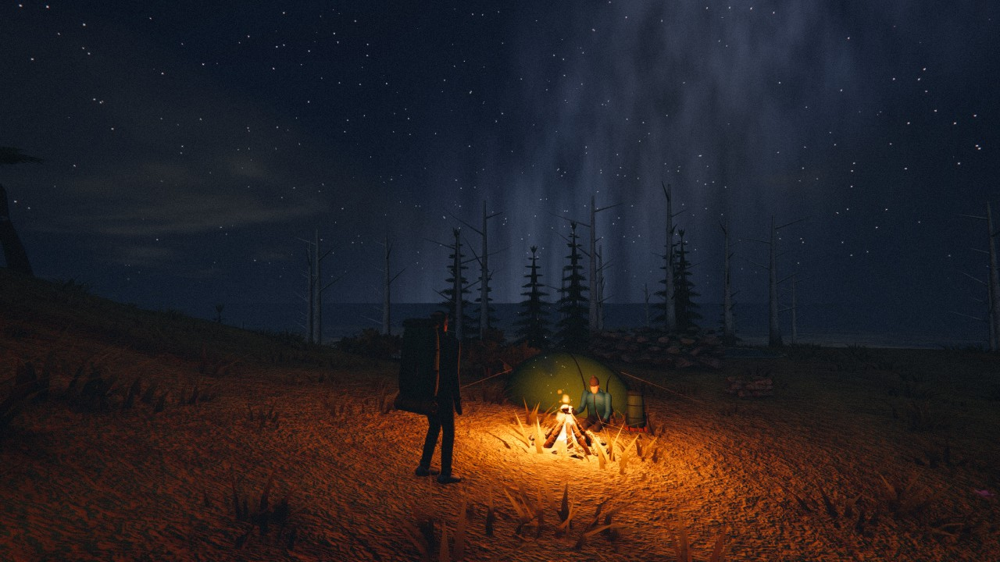<br><sub><b>Camp 2900</b>　bring a lighter and you can gather wood for a fire</sub></td>
  </tr>
  <tr>
    <td>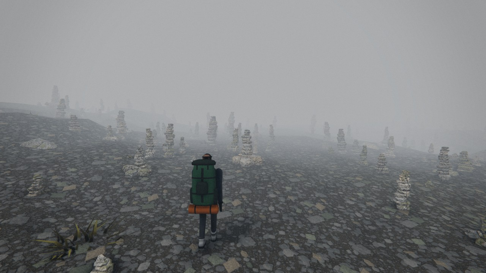<br><sub><b>Field of Ten Thousand Immortals</b>　a slope of hand-stacked cairns that look like figures in the fog</sub></td>
    <td>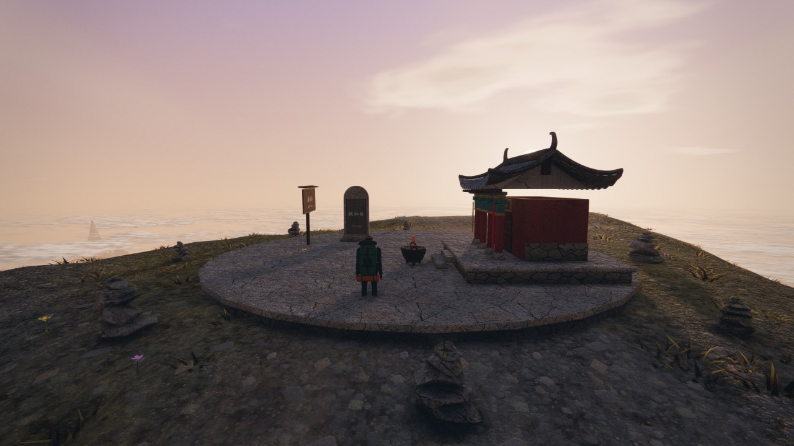<br><sub><b>Baxian Platform · 3,771 m</b>　sunrise on the summit of Mount Taibai</sub></td>
  </tr>
  <tr>
    <td>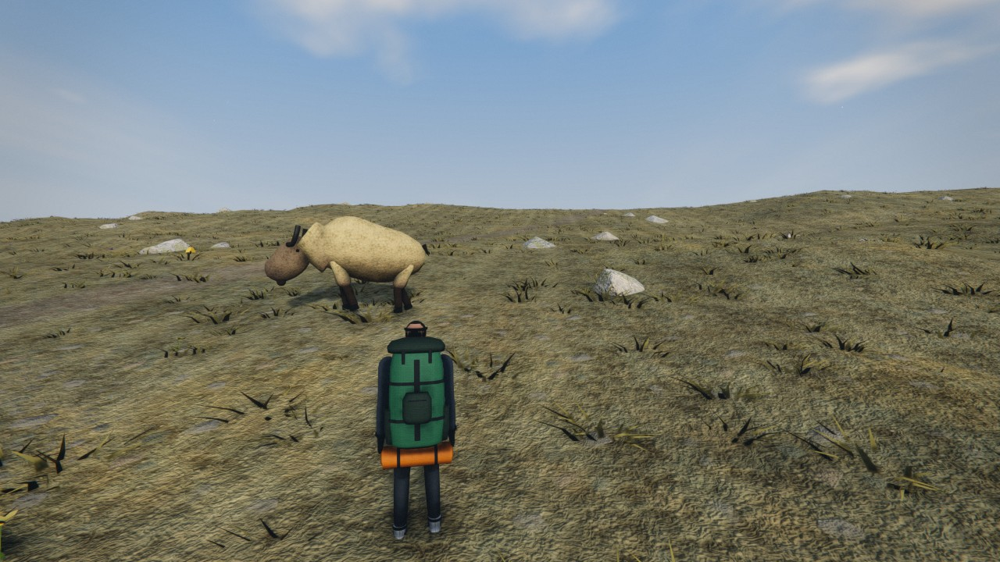<br><sub><b>Golden takin</b>　do not get close, and do not run</sub></td>
    <td>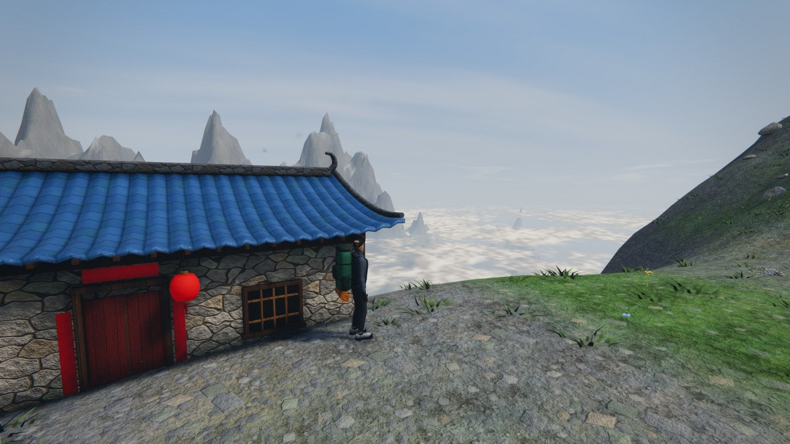<br><sub><b>Daye Lake</b>　the one place on the mountain that sells instant noodles</sub></td>
  </tr>
</table>

The same stretch of forest trail in four seasons:

<table>
  <tr>
    <td width="25%">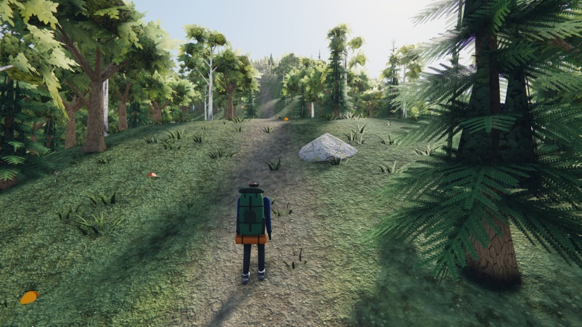</td>
    <td width="25%">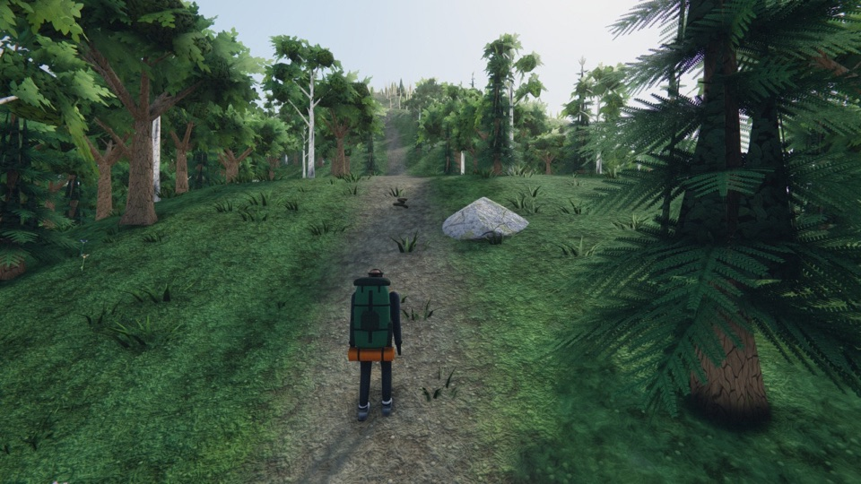</td>
    <td width="25%">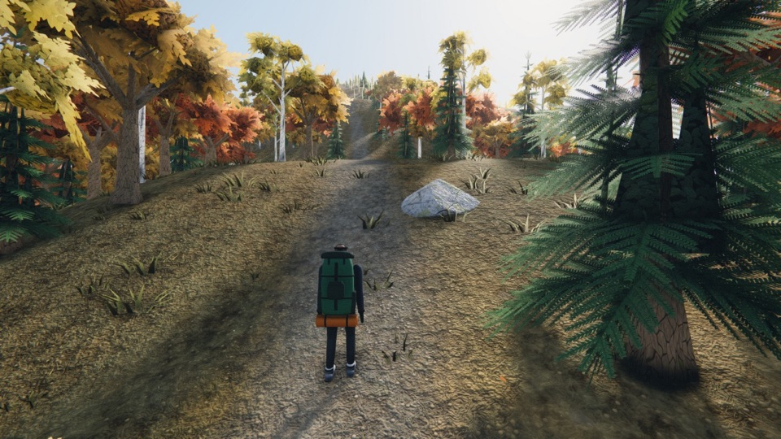</td>
    <td width="25%">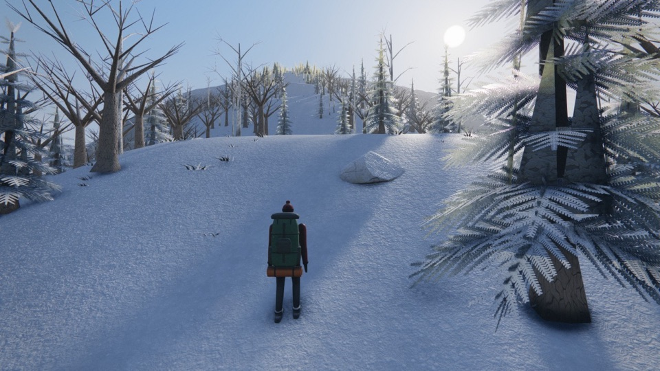</td>
  </tr>
  <tr>
    <td align="center"><sub>Spring · May</sub></td>
    <td align="center"><sub>Summer · July</sub></td>
    <td align="center"><sub>Autumn · September</sub></td>
    <td align="center"><sub>Winter · January</sub></td>
  </tr>
</table>

Everything above is captured in the game. Not one texture comes from an image file.

## How to play

**1. Pick a season and buy your gear.** Each season has its own temperatures, weather, snow cover, water sources, day length, plants and animals. Then you go shopping: backpack, tent, sleeping bag, clothing, navigation, cooking kit, food and medicine. The total weight cannot exceed what the pack can carry.

<table>
  <tr>
    <td width="33%">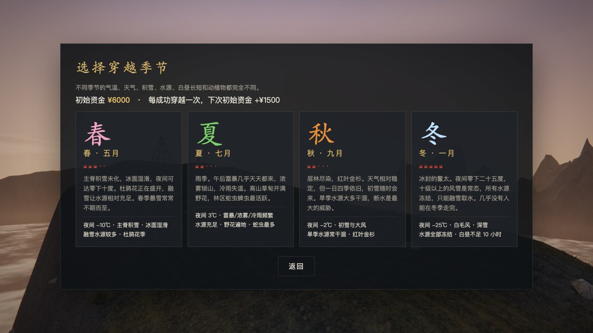</td>
    <td width="33%">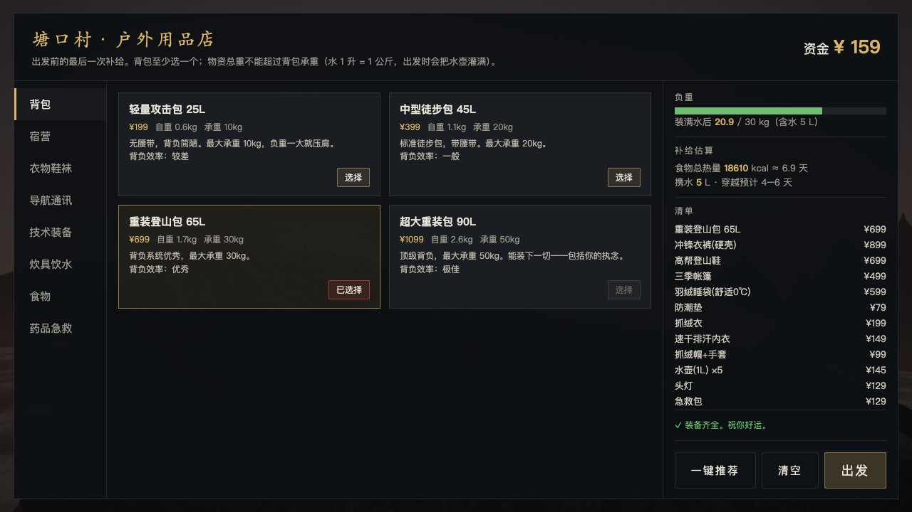</td>
    <td width="33%">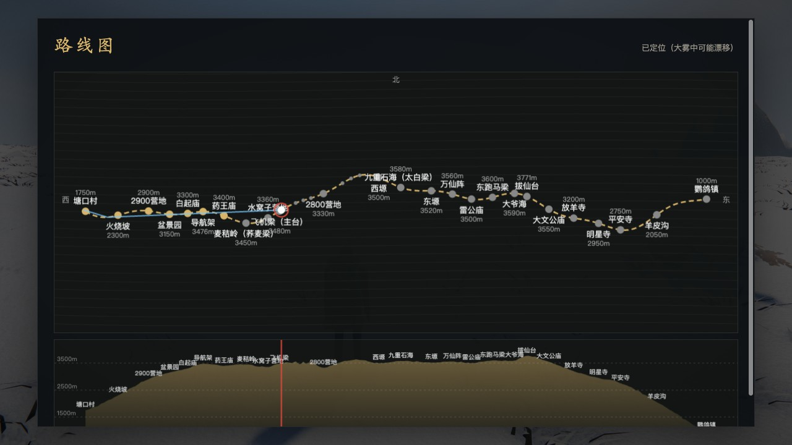</td>
  </tr>
  <tr>
    <td align="center"><sub>Four seasons, each dangerous in its own way</sub></td>
    <td align="center"><sub>The outdoor shop in Tangkou village</sub></td>
    <td align="center"><sub>Route map and elevation profile (if you bought a map)</sub></td>
  </tr>
</table>

**2. Go up, and stay alive.** You watch nine gauges at once: health, stamina, energy, food, water, body temperature, morale, altitude sickness and wetness. Add a layer when you are cold and take one off before you sweat. Pitch camp before dark. Refill at the camps, though the water source may be dry. You can catch rain and melt snow, and untreated water needs a purification tablet unless you want diarrhoea.

**3. The mountain does not negotiate.**

| From | What happens |
| --- | --- |
| Weather | Fog bends your sense of direction until you walk in circles, gusts throw you off the knife-edge, lightning follows the ridge, hail, whiteouts |
| Terrain | Sprains and fractures in the boulder fields, slides on wet or frosted slopes, rockfall |
| Animals | Charging takin, snakes in the forest, ticks in the grass (the bite feels like nothing at the time) |
| Yourself | Hypothermia, altitude sickness, dehydration, running out of food, snow blindness, and what appears in the fog once your morale has collapsed |

**4. Three endings.** You walk out alive at Yingge town. Or you send an SOS on a satellite messenger and a helicopter picks you up, with the rescue bill and an administrative penalty on you. Or you stay on the mountain. Each successful traverse adds 1,500 yuan to your starting budget next time.

<details>
<summary><b>Controls</b> (press H in the game to see them)</summary>

<br>

| Key | Action |
| --- | --- |
| `W` `A` `S` `D` | Walk |
| `Shift` | Run (costs stamina, worsens altitude sickness, and makes falls very likely in boulder fields) |
| `C` / `Z` | Crouch / go prone: resist gusts. In a thunderstorm crouch, do not lie flat |
| `X` | Deploy / stow trekking poles (stow them in a thunderstorm) |
| `J` (hold) | Jump on the spot to warm up |
| `Space` | Jump / stand up / keep your balance when prompted |
| `Mouse` · `V` | Look around · switch between first and third person |
| `B` | Backpack: eat, drink, change clothes, take medicine, boil water, call for rescue |
| `M` · `G` | Full route map · minimap (each needs the matching gear) |
| `E` | Interact: fetch water, read signs, shelter in a temple, talk to other hikers, buy supplies |
| `T` · `R` | Pitch camp or light a fire · sit down and rest |
| `1` `2` `3` | Drink · eat a snack · use the first-aid kit |
| `F` · `Q` | Headlamp · animal deterrent spray |
| `Esc` | Pause (graphics quality and god mode are here) |

Phones and tablets: play in landscape. The left thumb moves, the right thumb looks around, a pinch changes the camera distance, and everything else has a button.

Only here for the scenery? The pause menu has a **god mode**: all gauges stay full, holding Space takes off, and you can fly up to 10,000 m and look down on the clouds.

</details>

## How it is made

The repository contains no image, model or audio assets and no bundler. The only dependency is [Three.js](https://threejs.org/).

- **Terrain**: a height function plus streamed chunks. Forest, burnt slope, alpine meadow, knife-edge ridge, boulder field, cairn field and the other landforms are laid out along the elevation profile of the real landmarks.
- **Materials**: at startup the GPU bakes a set of tileable procedural PBR textures (colour, normal, roughness, crevice occlusion), applied by triplanar projection with no UVs. Snow cover, rain wetness, wind sway and light through leaves all happen in the shaders.
- **Modelling**: bevelled boxes, lathed shapes and lofted surfaces are assembled into temples, the navigation tower, a plane wreck, tents and takin. The hiker has a full skeleton with leg IK, a gait that changes with speed and slope, and leaves footprints in snow.
- **Lighting**: HDR → ambient occlusion → volumetric light → bloom → auto exposure → lens flare → AgX tone mapping → FXAA, sharpening and film grain. Near shadows are PCSS soft shadows; far away there are mountain shadows and cloud shadows.
- **Particles**: campfires, blowing snow, fireflies, breath in cold air. Most particles are stateless: their positions are computed on the GPU from time and a random seed.
- **Sound**: wind, rain, footsteps, thunder, heartbeat, breathing and a pentatonic soundtrack, all synthesised live with Web Audio.
- **Scaling**: four quality presets, automatic render-resolution scaling by frame rate, and a fallback to direct rendering if any step of the post-processing pipeline fails.

```
aotai/
├── index.html        entry point: detects the device, loads modules by version
├── style.css         interface styles
├── serve.py          local dev server (caching disabled)
├── vendor/           three.module.js (r169)
└── src/
    ├── main.js       game loop, flow, camping and fire, endings
    ├── data.js       route, seasons, gear and supplies
    ├── terrain.js    terrain height function, chunk streaming, vegetation and rocks
    ├── world.js      sky, lighting, sea of clouds, landmark buildings, signposts
    ├── materials.js  procedural PBR textures and materials
    ├── post.js       post-processing pipeline, soft shadows, distant shadows
    ├── weather.js    ten kinds of weather and the cloud layer
    ├── survival.js   backpack and survival gauges
    ├── hazards.js    takin, snakes, rockfall, gusts, lightning, hallucinations
    ├── player.js     movement, camera, stances
    ├── human.js      character model and animation
    ├── geo.js        modelling tools
    ├── fx.js         particle effects
    ├── fauna.js      birds, butterflies, eagles
    ├── audio.js      procedural audio and soundtrack
    ├── ui.js         HUD, shop, backpack, map
    ├── touch.js      touch controls
    └── noise.js      noise and random numbers
```

## Run it locally

You need Python 3 (it ships with macOS and most Linux distributions) and a modern browser with WebGL 2. Chrome is recommended.

```bash
git clone https://github.com/LeeSons/aotai.git
cd aotai
python3 serve.py
```

Then open <http://localhost:5173>.

Double-clicking `index.html` does not work, because browsers refuse to load ES modules from local files. Any static server will do; `serve.py` just turns caching off. Add `?touch=1` to the URL to force touch mode on a desktop.

## Contributing

Issues and pull requests are welcome. A few places to start:

- Interface text in English and other languages (only Chinese exists today)
- More real routes: Gongga, Langta, the Joseph Rock trail
- Things that happened to you on a real mountain and are missing from the game

If you have walked the Aotai line, or knew someone who did not walk out, you are also welcome to open an issue about anything in the game that does not match reality.

## Do not try this

The Aotai line has been officially closed since 2018. Anyone who gets into trouble on an illegal traverse pays for their own rescue and faces an administrative penalty. This game is a fictional experience. It is not a route guide, and it is certainly not encouragement.

The screen you see when you die carries one line: behind every name is someone who did not come home.

## License

[MIT](LICENSE) © LeeSons

The bundled [Three.js](https://github.com/mrdoob/three.js) (`vendor/three.module.js`) is also released under the MIT licence, copyright the Three.js authors.
