<div align="center">

<a href="https://leesons.github.io/aotai/">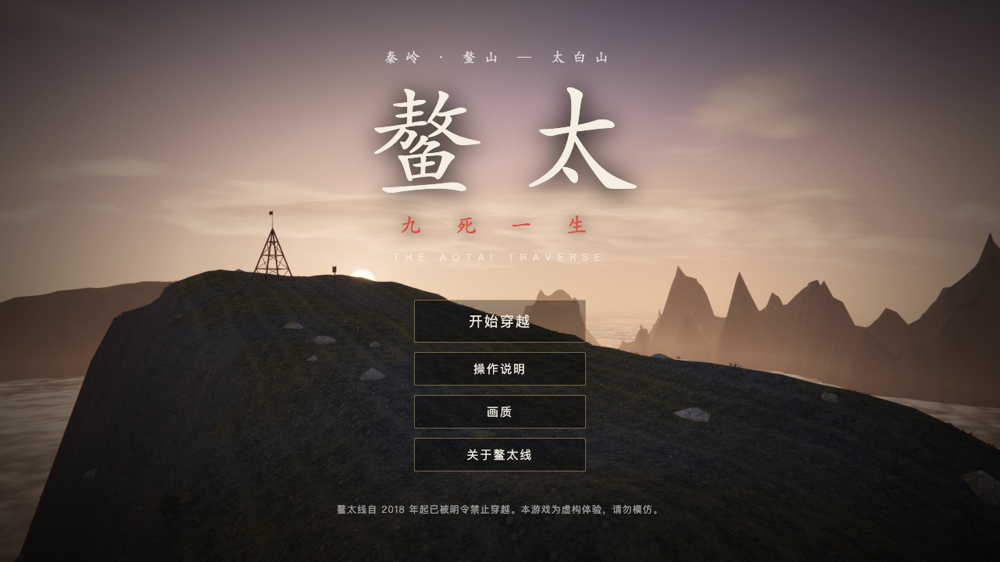</a>

# 鳌太 · 九死一生

**THE AOTAI TRAVERSE** · 一个跑在浏览器里的 3D 硬核徒步生存游戏

没有贴图，没有模型，没有音频文件，没有构建步骤。<br>
山、云、雪、人、风声和配乐，全部由一万行 JavaScript 现场算出来。

<a href="https://leesons.github.io/aotai/"></a>

[](LICENSE)


[](https://github.com/LeeSons/aotai/stargazers)

[在线试玩](https://leesons.github.io/aotai/) · [这是什么](#这是什么) · [玩法](#玩法) · [画面是怎么来的](#画面是怎么来的) · [本地运行](#本地运行) · [English](#english)

</div>

---

## 这是什么

鳌太线，是纵贯秦岭主脊、连接鳌山与太白山的一条高海拔穿越路线。主脊海拔 3400 米上下，石海连着刃脊，天气一日四季，水源时有时无，常被驴友称作国内最凶险的徒步线路之一。自 2018 年起，这条线已被明令禁止穿越。

现实里不能走，也不该走。那就在浏览器里走一遍。

你从塘口村（1750 m）进山，翻过导航架、麦秸岭、九重石海、万仙阵，登顶太白山主峰拔仙台（3771 m），再一路下撤到鹦鸽镇。全程 31 个地标，折合约 80 公里。出发前，你只有 6000 块钱，和村口的一家户外用品店。

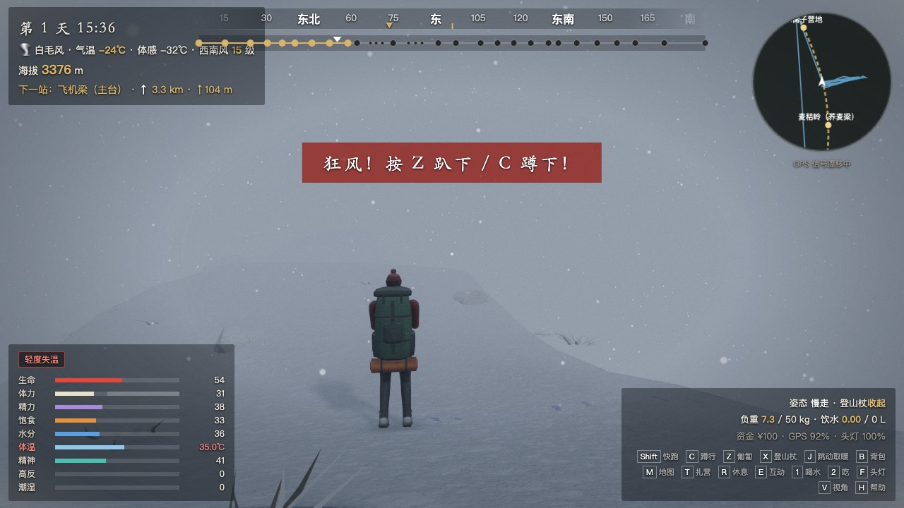

<p align="center"><sub>冬季主脊，白毛风。气温 −24℃，体感 −32℃，西南风 15 级，核心体温 35.0℃。屏幕中间那行红字不是装饰。</sub></p>

## 为什么值得点开

- **真的会死，而且每种死法都有出处。** 失温、坠崖、石海摔伤、雷击、高原肺水肿、脱水、蛇毒、被羚牛顶撞、蜱虫叮咬一两周后才发作的森林脑炎……一共 16 种死法，每一种都会告诉你现实里发生了什么。
- **第一道关在商店里。** 4 种背包、近 50 种物资，预算有限，背包有承重上限，水 1 升就是 1 公斤。带四季帐还是多带两天口粮？买 GPS 还是买卫星通讯器？
- **四个季节是四个游戏。** 春天主脊积雪未化，夏天午后天天雷暴，秋天水源干涸，冬天夜里零下二十五度、所有水源冻结。
- **一日四季的天气。** 晴、多云、浓雾、冷雨、雷暴雨、冰雹、雨夹雪、暴雪、狂风、白毛风，十种天气随季节和海拔轮转；山下看到的坏天气在主脊上，不在你脚下——暂时。
- **尽量照着真实规律做的身体。** 核心体温是用产热和散热算出来的：走路产热，吃下去的东西变成热量，衣服湿了保暖就没了，羽绒服淋雨等于白穿。重度失温时，你会不知不觉把衣服脱掉。
- **手机也能玩。** 同一个网址自动识别触屏，左手摇杆，右手转视角。

> 觉得有意思的话，点个 ⭐ 再走。这是让更多人看到它的唯一办法。

## 山上的样子

<table>
  <tr>
    <td width="50%">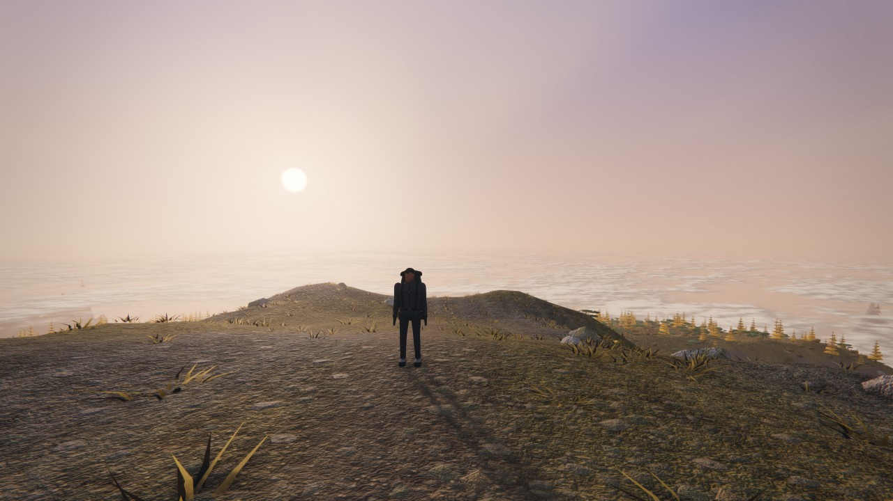<br><sub><b>导航架 · 3476 m</b>　黄昏，云海在脚下</sub></td>
    <td width="50%">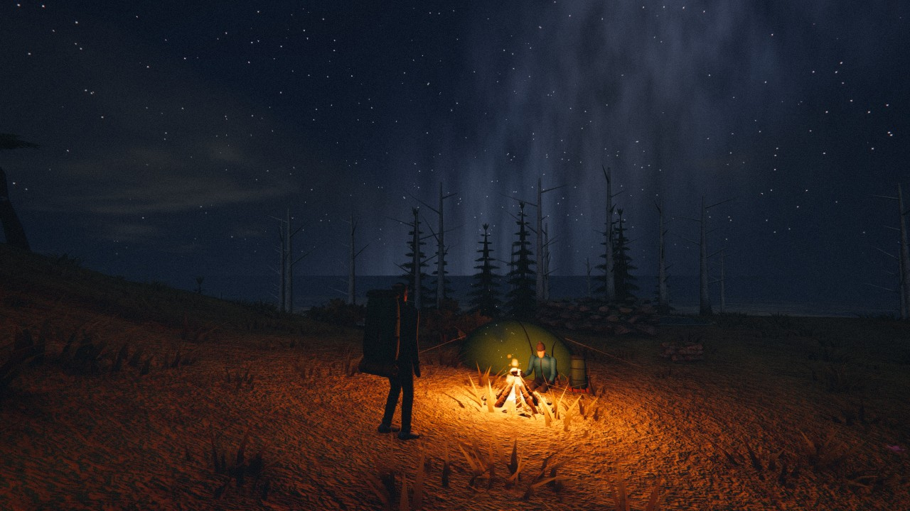<br><sub><b>2900 营地</b>　带了打火机，就能捡柴生火</sub></td>
  </tr>
  <tr>
    <td>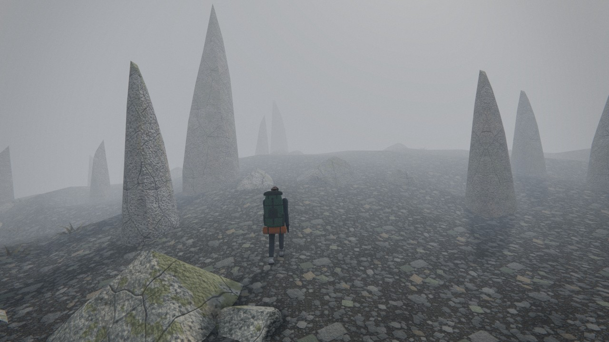<br><sub><b>万仙阵</b>　雾里的石柱，看起来像一个个人影</sub></td>
    <td>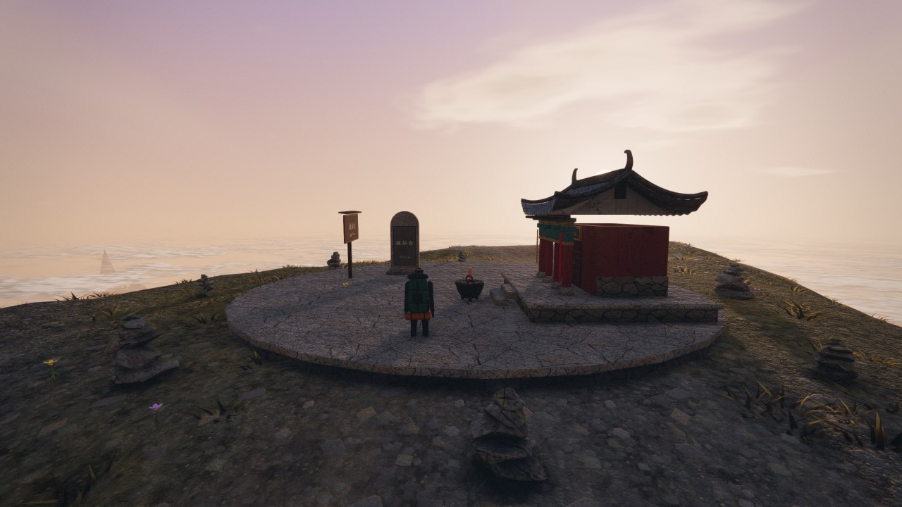<br><sub><b>拔仙台 · 3771 m</b>　太白山主峰的日出</sub></td>
  </tr>
  <tr>
    <td>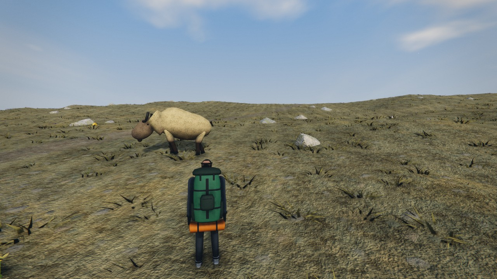<br><sub><b>金毛羚牛</b>　别靠近，别奔跑</sub></td>
    <td>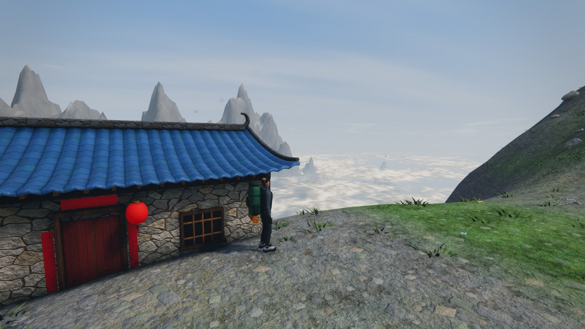<br><sub><b>大爷海</b>　山上能买到泡面的地方</sub></td>
  </tr>
</table>

同一段林道，四个季节：

<table>
  <tr>
    <td width="25%">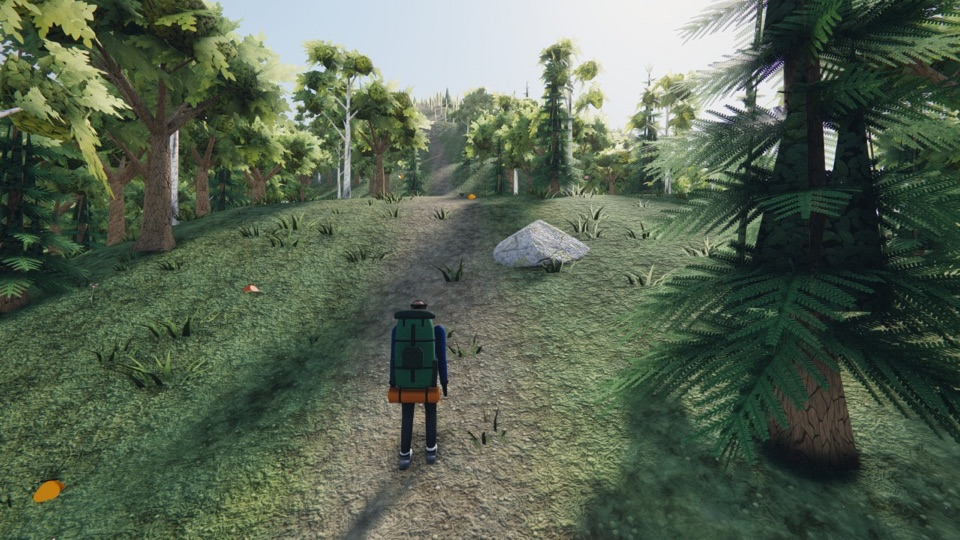</td>
    <td width="25%">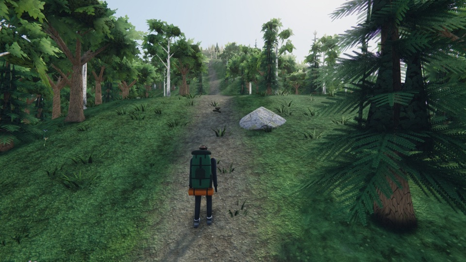</td>
    <td width="25%">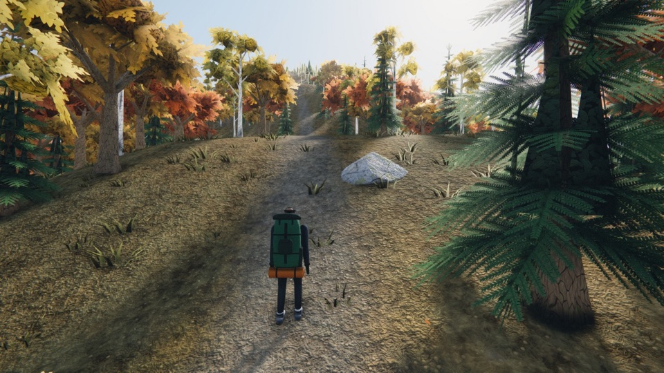</td>
    <td width="25%">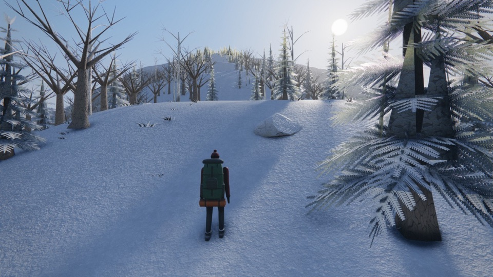</td>
  </tr>
  <tr>
    <td align="center"><sub>春 · 五月</sub></td>
    <td align="center"><sub>夏 · 七月</sub></td>
    <td align="center"><sub>秋 · 九月</sub></td>
    <td align="center"><sub>冬 · 一月</sub></td>
  </tr>
</table>

以上全部是游戏内实机画面，没有一张贴图来自图片文件。

## 玩法

**一、选季节，买装备。** 每个季节的气温、天气、积雪、水源、白昼长短和动植物都不一样。然后进店：背包、帐篷、睡袋、衣物、导航、炊具、食物、药品，总重不能超过背包承重。

<table>
  <tr>
    <td width="33%">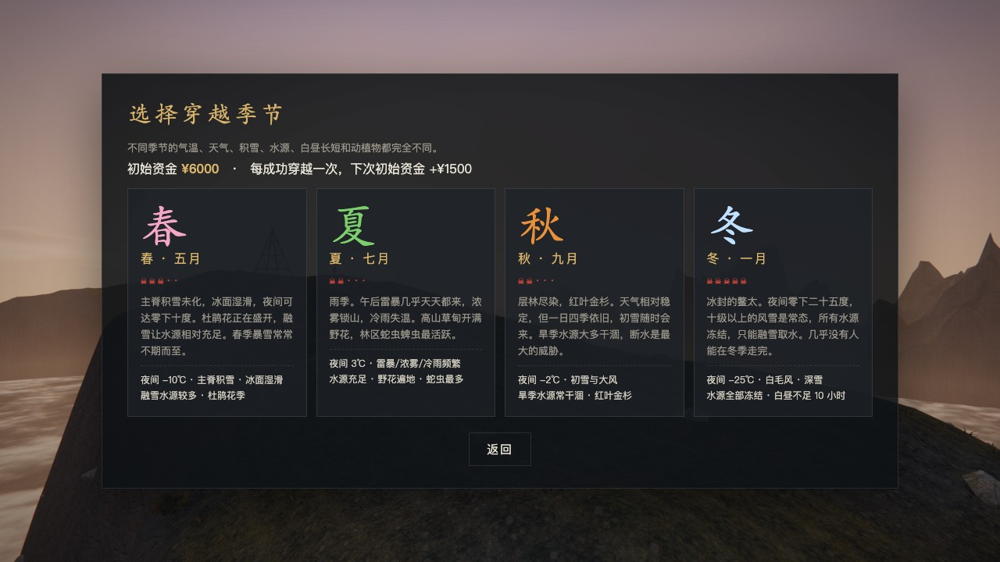</td>
    <td width="33%">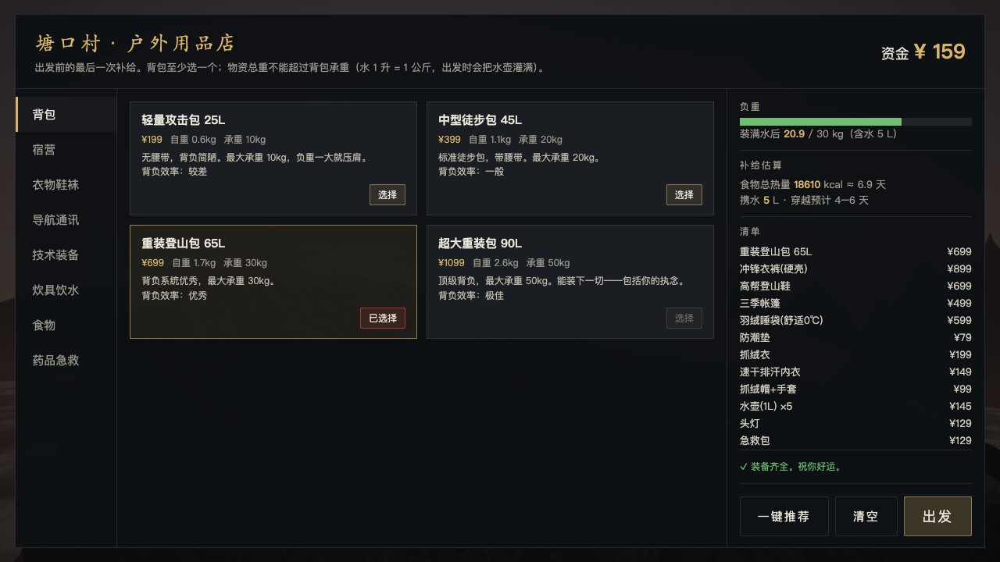</td>
    <td width="33%">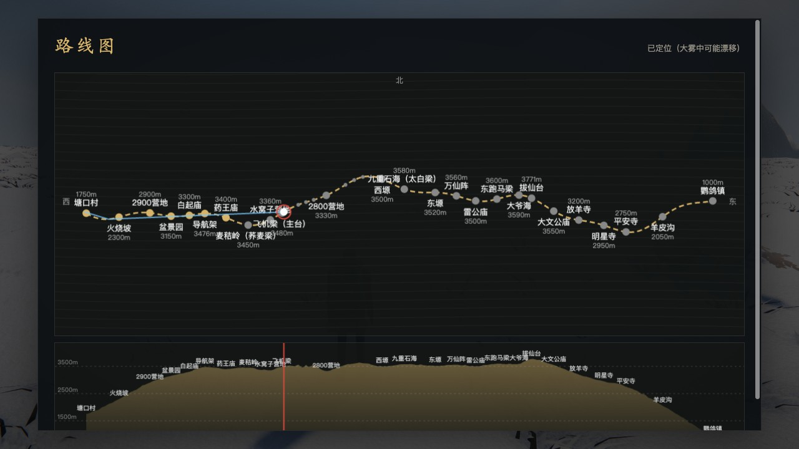</td>
  </tr>
  <tr>
    <td align="center"><sub>四个季节，危险各不相同</sub></td>
    <td align="center"><sub>塘口村 · 户外用品店</sub></td>
    <td align="center"><sub>路线图与海拔剖面（得带地图）</sub></td>
  </tr>
</table>

**二、进山，活着。** 你要同时照看九项指标：生命、体力、精力、饱食、水分、体温、精神、高反、潮湿。冷了加衣，出汗前减衣；天黑前扎营；在营地补水，但水源可能是干的。下雨能接雨水，有雪能融雪，生水要用净水片，不然腹泻。

**三、山不讲道理。**

| 来自 | 会发生什么 |
| --- | --- |
| 天气 | 大雾里方向感偏移（鬼打墙），阵风把人掀下刃脊，雷暴追着山脊打，冰雹，白毛风 |
| 地形 | 石海崴脚、骨折，湿滑结霜的陡坡滑坠，落石 |
| 动物 | 羚牛冲撞，林区的蛇，草丛里的蜱虫（咬完当时没事） |
| 自己 | 失温、高反、脱水、断粮、雪盲，以及精神垮掉之后雾里出现的东西 |

**四、三种结局。** 活着走到鹦鸽镇；用卫星通讯器发出 SOS 被直升机接走（救援费自理，另有行政处罚）；或者，留在山上。每成功穿越一次，下次的初始资金 +1500。

<details>
<summary><b>键位一览</b>（游戏里按 H 也能看）</summary>

<br>

| 按键 | 作用 |
| --- | --- |
| `W` `A` `S` `D` | 慢走 |
| `Shift` | 快跑（耗体力、加重高反，石海里极易摔倒） |
| `C` / `Z` | 蹲行 / 匍匐：抵御阵风；打雷时要蹲，别趴 |
| `X` | 展开 / 收起登山杖（雷暴时记得收起） |
| `J`（按住） | 原地跳动取暖 |
| `空格` | 跳跃 / 起身 / 危险时稳住平衡 |
| `鼠标` · `V` | 转动视角 · 切换第一 / 第三人称 |
| `B` | 背包：吃喝、穿脱衣物、用药、烧水、求救 |
| `M` · `G` | 全线地图 · 小地图（需要对应装备） |
| `E` | 互动：取水、看路牌、进庙避风、和驴友说话、买补给 |
| `T` · `R` | 扎营 / 生火 · 坐下休息 |
| `1` `2` `3` | 喝水 · 吃零食 · 急救包 |
| `F` · `Q` | 头灯 · 防兽喷雾 |
| `Esc` | 暂停（画质、无敌模式在这里） |

手机 / 平板：横屏，左手摇杆移动，右手滑动转视角、双指捏合调视距，其余操作都有按钮。

只想看风景？暂停菜单里有**无敌模式**：指标锁满，长按空格起飞，最高能飞到海拔一万米，从云顶上看云海。

</details>

## 画面是怎么来的

仓库里没有任何图片、模型或音频素材，也没有打包工具。除了 [Three.js](https://threejs.org/)，没有别的依赖。

- **地形**：高度函数 + 分块流式加载。林区、火烧坡、高山草甸、刃脊、石海、石林，八种地貌沿着真实地标的海拔剖面铺开。
- **材质**：开局在显卡上烘焙一套可平铺的程序化 PBR 贴图（颜色、法线、粗糙度、缝隙遮蔽），三平面投影，不需要 UV。积雪、雨湿、风中摆动、叶片透光都在着色器里。
- **建模**：倒角方块、旋转体、放样曲面拼出寺庙、导航架、飞机残骸、帐篷和羚牛。人物有完整骨架，腿部 IK 落脚，步态随速度和坡度变化，雪地上会留脚印。
- **光影**：HDR → 环境光遮蔽 → 体积光 → 泛光 → 自动曝光 → 镜头光晕 → AgX 色调映射 → FXAA、锐化、胶片颗粒。近处是 PCSS 软阴影，远处有山体投影和云影。
- **粒子**：营火、风吹雪、萤火虫、呵出的白气。大部分粒子是无状态的，位置由时间和随机种子在显卡上算出来。
- **声音**：风、雨、脚步、雷、心跳、呼吸，以及五声音阶的配乐，全部用 Web Audio 实时合成。
- **适配**：流畅 / 均衡 / 高清 / 极致四档画质，按帧率自动调整渲染分辨率；后期管线任何一步出错都会自动退回直接渲染。

```
aotai/
├── index.html        入口：识别设备，按版本号加载模块
├── style.css         界面样式
├── serve.py          本地开发服务器（禁用缓存）
├── vendor/           three.module.js（r169）
└── src/
    ├── main.js       游戏主循环、流程、扎营生火、结局
    ├── data.js       路线、季节、装备与物资数据
    ├── terrain.js    地形高度函数、分块加载、植被与岩石
    ├── world.js      天空、光照、云海、地标建筑、路标
    ├── materials.js  程序化 PBR 贴图与材质
    ├── post.js       后期处理管线、软阴影、远距离阴影
    ├── weather.js    十种天气与云层
    ├── survival.js   背包与生存指标
    ├── hazards.js    羚牛、蛇、落石、阵风、雷击、幻觉
    ├── player.js     移动、相机、姿态
    ├── human.js      人物模型与动作
    ├── geo.js        建模工具
    ├── fx.js         粒子特效
    ├── fauna.js      鸟群、蝴蝶、鹰
    ├── audio.js      程序化音频与配乐
    ├── ui.js         HUD、商店、背包、地图
    ├── touch.js      触屏操作
    └── noise.js      噪声与随机数
```

## 本地运行

需要 Python 3（macOS 和大多数 Linux 自带）和一个支持 WebGL 2 的现代浏览器，推荐 Chrome。

```bash
git clone https://github.com/LeeSons/aotai.git
cd aotai
python3 serve.py
```

然后打开 <http://localhost:5173>。

不能直接双击 `index.html`：浏览器不允许从本地文件加载 ES 模块。换成任何静态服务器都行，`serve.py` 只是顺手关掉了缓存。网址后加 `?touch=1` 可以在电脑上强制触屏模式。

## 参与

欢迎提 Issue 和 PR。几个可以下手的方向：

- 英文等其他语言的界面文本（目前只有中文）
- 更多真实路线：贡嘎、狼塔、洛克线……
- 你在山上真实遇到过、而游戏里没有的事

如果你走过鳌太，或者认识没能走出来的人，也欢迎在 Issue 里指出游戏里不符合实际的地方。

## 请勿模仿

鳌太线自 2018 年起已被明令禁止穿越，非法穿越遇险的救援费用由当事人承担，并将面临行政处罚。本游戏是虚构体验，不是攻略，更不是鼓励。

游戏里的遇难画面上写着一句话：每一个名字背后，都是一个没有回家的人。

## License

[MIT](LICENSE) © LeeSons

内含的 [Three.js](https://github.com/mrdoob/three.js)（`vendor/three.module.js`）同样以 MIT 协议发布，版权归 Three.js 作者所有。

## English

**The Aotai Traverse** is a hardcore hiking-survival game that runs entirely in the browser.

The Aotai line is a high-altitude ridge traverse across China's Qinling Mountains, linking Mount Ao and Mount Taibai (3,771 m). It is notorious for sudden weather, long waterless stretches and boulder fields, and has been officially closed to hikers since 2018. This game lets you attempt it anyway: pick a season, spend a tight budget on gear, then manage core temperature, hydration, altitude sickness, injuries and morale across 31 real landmarks. There are 16 ways to die, and each one comes with an explanation of what happens in real life.

Everything is procedural. Terrain, PBR textures, trees, buildings, the hiker's walk cycle, ten kinds of weather, sound effects and the pentatonic soundtrack are all generated at runtime by about 11,000 lines of vanilla JavaScript on top of Three.js. There are no image, model or audio files and no build step.

**[Play it here](https://leesons.github.io/aotai/)**, on desktop or phone. In-game text is Chinese only for now; localization PRs are very welcome.
